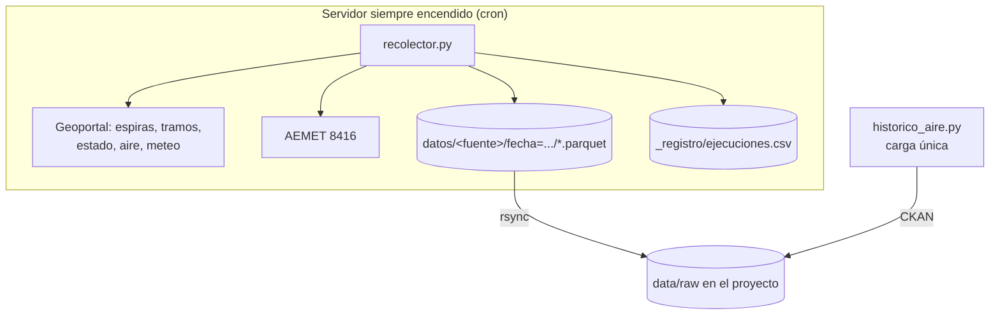

# Proyecto 4 · Big Data urbano (Valencia)

## Descripción y objetivo

Objetivo: pipeline completo de ingeniería de datos (batch + streaming) sobre datos abiertos de tráfico, calidad del aire y meteorología de Valencia. Los datos se cruzan con Spark y el proyecto termina con dos modelos predictivos: uno principal de NO₂ horario y uno secundario de intensidad de tráfico.

## Arquitectura


## Bitácora de prácticas

### Bloque 1 — Ingesta de datos abiertos urbanos

#### Fuentes de datos

Las capas del Geoportal se consultan todas igual, cambiando solo el número de capa:
`https://geoportal.valencia.es/server/rest/services/OPENDATA/<capa>/query?where=1=1&outFields=*&f=json`

| Fuente | Capa / endpoint | Ficha | Frecuencia | Histórico | API key |
|---|---|---|---|---|---|
| Espiras de tráfico | `Trafico/MapServer/208` | [enlace](https://opendata.vlci.valencia.es/dataset/punts-mesura-trafic-espires-electromagnetiques-puntos-medida-trafico-espiras-ele) | Cada pocos minutos | No | No |
| Tramos de tráfico | `Trafico/MapServer/188` | [enlace](https://opendata.vlci.valencia.es/dataset/intensitat-transit-trams-intensidad-trafico-tramos) | Cada pocos minutos | No | No |
| Estado del tráfico | `Trafico/MapServer/192` | [enlace](https://opendata.vlci.valencia.es/dataset/estat-transit-temps-real) | Cada 3 min | No | No |
| Calidad del aire | `MedioAmbiente/MapServer/156` | [enlace](https://opendata.vlci.valencia.es/dataset/estacions-contaminacio-atmosferiques-estaciones-contaminacion-atmosfericas) | Horaria | No | No |
| Meteo municipal | `MedioAmbiente/MapServer/157` | [enlace](https://opendata.vlci.valencia.es/dataset/estacions-atmosferiques-estaciones-atmosfericas) | Horaria | No | No |
| AEMET (estación 8416) | `opendata.aemet.es/opendata/api/observacion/convencional/datos/estacion/8416` | [enlace](https://opendata.aemet.es/centrodedescargas/inicio) | Horaria | Últimas 24 h | Sí |
| Histórico aire 2016–2022 | CKAN `datastore_search` | [enlace](https://opendata.vlci.valencia.es/dataset/hourly-air-quality-data-since-2016) | Carga única | Sí | No |

Ninguna fuente del Geoportal guarda histórico, solo dan el estado actual. Por eso hay que ir guardando capturas periódicas.

Campos que usamos de cada fuente:

- **Espiras:** `idpm` (punto de medida), `ih` (vehículos/hora; -1 o null si no hay dato), `fecha_actualizacion` (epoch en ms).
- **Tramos:** `idtramo`, `des_tramo` (calle), `lectura` (intensidad; -1 sin dato), `imv` (intensidad media).
- **Estado:** `idtramo`, `denominacion` (calle), `estado` (código de estado del tráfico).
- **Aire:** `nombre` (estación), `no2`, `pm10`, `pm25` (µg/m³), `fecha_carg` (epoch en ms).
- **Meteo municipal:** `nombre`, `temperatur`, `humedad_re`, `viento_vel`, `viento_dir`, `precipitac`, `fecha_carg`.
- **AEMET:** se pide en dos pasos. La primera llamada, con la cabecera `api_key`, devuelve una URL en el campo `datos`, y esa URL tiene las observaciones. La clave está en `.env` y no se sube a Git.

#### Diagrama de la ingesta



#### Programación con cron

```cron
15 * * * *   cd /opt/recolector && flock -n /tmp/rec_horario.lock venv/bin/python recolector.py espiras tramos aire meteo >> logs/cron.log 2>&1
*/15 * * * * cd /opt/recolector && flock -n /tmp/rec_estado.lock venv/bin/python recolector.py estado >> logs/cron.log 2>&1
20 */6 * * * cd /opt/recolector && flock -n /tmp/rec_aemet.lock venv/bin/python recolector.py aemet >> logs/cron.log 2>&1
```

- **Espiras, tramos, aire y meteo, cada hora:** `ih` es la intensidad de la última hora y el aire se actualiza cada hora, así que con una foto por hora no se pierde nada.
- **Estado del tráfico, cada 15 min:** cambia cada 3 minutos; para batch basta con una muestra cada cuarto de hora.
- **AEMET, cada 6 h:** cada llamada trae las últimas 24 h, así que con 4 al día no quedan huecos y no se supera el límite de peticiones.
- `flock -n` evita que se lancen dos ejecuciones a la vez si una se queda colgada.

#### Incidencias

- Hay espiras con `ih` y `fecha_actualizacion` a null, es decir, sensores sin lectura.
- En espiras y tramos el valor -1 significa "sin dato".
- En tramos, `imv` llega como texto en vez de número.
- En meteo los nombres de campo vienen recortados (`temperatur`, `humedad_re`).
- No todas las estaciones miden todos los contaminantes, así que hay nulos.
- La ficha de espiras aparece en el portal como "temporalmente con errores de procesamiento".
- La primera ejecución de AEMET falló con `'AEMET_API_KEY'` porque la clave no se había cargado del `.env`; quedó registrado en `ejecuciones.csv` y la siguiente ejecución ya funcionó.
- Entre el 28/10 a las 18:30 UTC y el 29/10 a las 12:30 UTC no hay capturas: el equipo estuvo apagado y cron no se ejecutó. Por eso el recolector debe ir en un servidor siempre encendido.
- Cada llamada a AEMET devuelve 13 observaciones, no 24 como se esperaba.


#### Comparativa Python vs NiFi

Se ha añadido un UpdateAttribute entre SplitJson y PutFile para dar a cada fichero un nombre con marca de tiempo; sin él, todos los trozos tendrían el mismo nombre.

| Aspecto | Recolector Python | Flujo NiFi |
|---|---|---|
| Tiempo de desarrollo | Rápido: añadir una fuente es una línea en `FUENTES` | Más lento: hay que configurar cada procesador y todas sus relaciones a mano |
| Facilidad para depurar un fallo | El traceback indica la línea exacta y el error queda en `ejecuciones.csv` | Aparece un aviso en el procesador, pero la causa hay que buscarla en el log del contenedor |
| Visibilidad del estado en ejecución | Solo `cron.log` y `ejecuciones.csv` | Muy buena: contadores, colas y Data Provenance de cada flowfile |
| Facilidad de versionado en Git | Muy fácil: un `.py` legible en el diff | Un `.json` largo y difícil de leer en el diff |
| Recursos necesarios en el servidor | Mínimos: Python, `requests` y `pyarrow`; se ejecuta y termina | Altos: Java en Docker siempre encendido |


